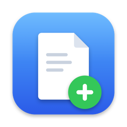
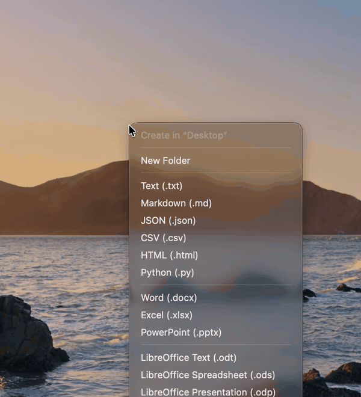

<div align="center">
<table><tr>
<td width="150" align="center" valign="middle"></td>
<td valign="middle" align="left">

<h1>Blankly</h1>

Create a new file or folder right where you are on macOS.<br>
Press <kbd>Control</kbd> + <kbd>Option</kbd> + <kbd>N</kbd>, pick a format, type a name.

<a href="https://github.com/Guf-Hub/blankly/releases/latest"><b>⬇ Download for macOS</b></a> &nbsp;·&nbsp; <a href="#support">♥ Support</a> &nbsp;·&nbsp; <b>English</b> | <a href="docs/README.ru.md">Русский</a>

<a href="https://github.com/Guf-Hub/blankly/releases/latest"></a>
<a href="https://github.com/Guf-Hub/blankly/releases"></a>

<a href="https://github.com/Guf-Hub/blankly/actions/workflows/test.yml"></a>
<a href="LICENSE"></a>
<a href="https://github.com/Guf-Hub/blankly/stargazers"></a>

</td>
</tr></table>
</div>

<p align="center"></p>

---

macOS has no "New → Text Document" like Windows does. Blankly adds it as a small background app.

## How it works

There are three ways to open Blankly:

- Press **Control + Option + N** anywhere. A menu opens next to the cursor.
- Right-click an empty spot in a Finder window or on the Desktop → **New File** → pick a format.
- Click the Blankly button in the Finder toolbar (see [Finder](#finder) below).
- Or give a format its own shortcut — say **Control + Option + W** for Word — and skip the menu entirely (see [Settings](#settings)).

Then choose **New Folder** or a file format, type a name and press Enter. The name is pre-filled and selected, so you can just start typing.

**Where the file goes**

- In Finder — into the folder open in the front window. The new file is selected.
- In any other app — onto the Desktop, right where the cursor was.
- If the name is taken, Blankly adds a number: `Notes 1.txt`.

**Formats:** `txt`, `rtf`, `md`, `json`, `csv`, `html`, `py`, `docx`, `xlsx`, `pptx`, `pages`, `numbers`, `key`, `odt`, `ods`, `odp`. For code, off by default — turn them on in **Settings → Formats**: `sh`, `rb`, `php`, `js`, `css`, `xml`, `yaml`, `swift`, `tex`.

- Only formats your Mac can open are shown. No Word or Pages — no `.docx` in the menu.
- Hide formats you never use and drag the rest into your own order in **Settings → Formats**. The menu, the Finder right-click and the toolbar button all follow it. A hidden format keeps its shortcut.
- Files are empty, except `html` (an HTML5 starter page), `rtf`, Office and iWork (Pages, Numbers, Keynote) documents, and a first line where a format needs one (`<?php`, `<?xml …?>`, a LaTeX skeleton).
- Scripts (`sh`, `py`, `rb`) start with a `#!` line and are created executable, ready for `./script.sh`.
- Office and iWork (Pages, Numbers, Keynote) files are real empty documents, not zero-byte files, so Word, Excel, Pages, Numbers, Keynote and LibreOffice open them without complaints.

**Your own templates.** Settings → **Templates Folder…** opens a folder. Any file you put there shows up in the menu under *My Templates*, and new files are copies of it — a `.py` with your boilerplate, a `.yaml` config, anything. A **folder** in there works too: it shows up in the menu and is copied whole, with everything inside. In the Finder menu they are under **More…**.

This is also how to add formats only their own app can create — Photoshop, AutoCAD, a video editor project: create an empty document in that app and save it into the Templates folder.

**Variables in templates.** In a template's file name and inside text templates (UTF-8), Blankly replaces `{date}` with `2026-11-05`, `{time}` with `14-30` and `{name}` with the name you typed. For a template folder this applies to the names of files inside it as well. Binary files (such as `.docx`) are copied untouched. The name suggested in the name dialog is the template's own name with `{date}` and `{time}` filled in.

**From Clipboard.** If the clipboard holds text or an image, the menu has **From Clipboard…** (also in the Finder right-click menu). Text becomes `.txt`; valid JSON (an object or array) becomes `.json`; text starting with `<!DOCTYPE` or `<html` becomes `.html`. An image becomes `.png`. Blankly then asks for a name (default *From Clipboard*) and saves the file.

## Settings

Open the menu (Control + Option + N) → **Settings…** at the bottom.

| Setting | What it does |
|---|---|
| Shortcut | Click the field and press a new combination. It must include ⌘, ⌃ or ⌥. Esc or switching to another app cancels. If another app already uses it, Blankly says so. |
| Formats | **Set Up…** opens a list: New Folder and every format. Each row has a **Show** checkbox (at least one item must stay), a shortcut field and **Open in…**, the app that opens this file type by default (macOS asks you to confirm the change; for HTML only browsers are listed, because macOS makes the chosen one your default web browser too). Drag rows to set the order. For a shortcut, click a field and press **Control + Option** + a key. Pressing it later asks for a name and creates that file right away, no menu. The menu shows the shortcut next to its format. Blankly warns if the shortcut is already used by its menu, another format, macOS (Settings → Keyboard → Keyboard Shortcuts) or another app. Control + Option is required because macOS can't tell which shortcuts other apps use inside their own menus, and those rarely use this pair. |
| Language | English, Русский, Deutsch, Français, Español, 简体中文 or 日本語. By default Blankly follows the system language and falls back to English. |
| Open at login | Starts Blankly in the background when you log in, so the shortcut always works. |
| Finder right-click | **Turn On…** opens the macOS list of Finder extensions; enable Blankly there. |
| Open file right after creating | Off by default. When on, a new file opens in its default app. A folder is only selected in Finder. If nothing can open the file, it is just selected. |
| Don't ask for a name — rename in Finder | Off by default. When on, the file is created at once and Finder starts renaming it, as with its own New Folder. Needs the Accessibility permission (macOS asks once). |
| Check for updates daily | See [Updates](#updates). |
| Templates Folder… / Change… | The path above the buttons shows where your templates are. **Templates Folder…** opens it. **Change…** picks another folder, for example one in iCloud Drive to share templates between Macs; templates you already have are copied there. |

## Finder

Right-click and the toolbar button come from a Finder extension inside Blankly. Turn it on once: Settings → **Turn On…** next to *Finder right-click* → enable Blankly in the list.

The toolbar button is optional. Right-click the Finder toolbar → **Customize Toolbar…** → drag Blankly onto it. Click it to get the same list of formats.

macOS always puts items from apps at the bottom of the right-click menu — Blankly can't move its item higher.

In iCloud Drive macOS doesn't show app items in the right-click menu at all. There, use the toolbar button or Control + Option + N — both work.

## Updates

Blankly updates itself with [Sparkle](https://sparkle-project.org), the standard updater for Mac apps.

- Once a day it reads a small file from the latest GitHub release. If there is a newer version, the top of the menu says *Version X is available — update*. Click it, then **Install Update** — Blankly downloads, replaces itself and restarts. No popups out of nowhere.
- You can also check any time: menu → **Check for Updates…**
- Every update is signed with the author's private key, and Blankly refuses an update with a wrong signature — even if someone took over the GitHub account.
- Nothing about you or your Mac is sent. You can turn the daily check off in Settings.
- Installed with Homebrew? Updates come either way; `brew upgrade` is not needed.

Versions 1.0–1.2 don't have Sparkle yet: update to 1.3 once by hand (or `brew upgrade --cask blankly`), after that it's automatic.

## Install

**Homebrew:**

```bash
brew tap guf-hub/tap
brew trust --cask guf-hub/tap/blankly
brew install --cask guf-hub/tap/blankly
```

**Or manually:** download `Blankly.dmg` from the [latest release](../../releases/latest), open it and drag Blankly to Applications.

**First launch** (both ways):

1. Open Blankly from Applications. Blankly is not notarized by Apple (that needs a paid developer account), so the first time macOS shows *"Blankly.app" Not Opened — Apple could not verify…*. This is expected. To get past it once:
   1. Click **Done**. Do **not** click *Move to Trash*.
   2. Open  → **System Settings** → **Privacy & Security**.
   3. Scroll down to *Security*. Next to *"Blankly.app" was blocked…* click **Open Anyway** and confirm with your password or Touch ID.
   4. In the dialog that appears, click **Open Anyway** again.

   After that Blankly opens normally. Prefer the Terminal? This does the same:
   ```bash
   xattr -dr com.apple.quarantine /Applications/Blankly.app
   ```
2. When asked whether Blankly may control Finder, click **Allow**. It needs this to know which folder is open.
3. Open **Settings…** and turn on **Open at login**.
4. Optional: turn on the Finder extension — see [Finder](#finder).

Requires macOS 13 or later. Apple Silicon and Intel.

## If something goes wrong

Blankly writes errors to the macOS system log. File names and paths are not written there, only the format and an error code. Nothing is sent anywhere.

To see the last hour, run in Terminal:

```bash
log show --predicate 'subsystem == "app.blankly"' --last 1h --style compact
```

Or open **Console**, search for `app.blankly` and repeat what went wrong.

To report a bug, save the log to a file on your Desktop:

```bash
log show --predicate 'subsystem == "app.blankly"' --last 1d --style compact > ~/Desktop/blankly-log.txt
```

Then open [Issues](../../issues/new/choose), describe what you did and attach `blankly-log.txt`. If Blankly crashed, also attach the newest `Blankly…` report from `~/Library/Logs/DiagnosticReports`.

## Uninstall

```bash
brew uninstall --zap --cask blankly
```

Without Homebrew: quit Blankly (menu → **Quit**), move it from Applications to the Trash, and delete `~/Library/Application Support/Blankly` (your templates, unless you moved them with **Change…**) if you don't need it.

## Build from source

Needs Xcode or Command Line Tools.

```bash
zsh build.sh              # build and install to /Applications
zsh build.sh --no-install # build only: build/Blankly.app, .zip and .dmg
zsh release.sh --notes "…" --notes-ru "…" # maintainer: build, sign the update, publish a GitHub release
```

**Releasing (maintainer).** `--notes` (Markdown) goes both into the GitHub release and into the update window of Blankly; `--notes-ru` adds the Russian text, shown on a Russian Mac. Other arguments go to `gh release create` (for example `--prerelease`).

By default the build is signed ad-hoc on your Mac. A Developer ID build, signed and notarized by Apple, comes from GitHub Actions: run the **release-build** workflow (Actions → release-build → Run workflow), then publish its result with `zsh release.sh --from-ci <run-id> --notes "…"`. The update archive is still signed with the Sparkle key on the maintainer's Mac. Without the signing secrets the workflow simply makes an ad-hoc build. Details: [CONTRIBUTING.md](CONTRIBUTING.md#code-signing-maintainers).

The first build downloads [Sparkle](https://github.com/sparkle-project/Sparkle) 2.10.0 into `.vendor/` and checks its SHA-256.

| File | What's in it |
|---|---|
| `main.swift` | The app: menu, file creation, shortcuts, Settings and Formats windows |
| `Core.swift` | Logic without UI: strings in 7 languages, names, templates and variables, clipboard, shortcut conflicts |
| `Formats.swift` | The list of built-in formats (shared with the Finder extension) |
| `FormatOrder.swift` | Format order and hiding (shared with the Finder extension) |
| `Languages.swift` | Supported languages and choosing one (shared with the Finder extension) |
| `FinderExtension.swift` | The Finder extension: right-click menu and toolbar button |
| `icon.swift` | Draws the app icon |
| `Resources/templates` | Empty Office documents |
| `build.sh`, `sign.sh`, `release.sh` | Build, sign, publish |

Notes for AI coding agents: [AGENTS.md](AGENTS.md).

### Tests

`zsh test.sh` compiles everything except `main.swift` (logic, format list, format order, languages and the Finder extension) with `Tests/*.swift` using plain `swiftc` (no Xcode project) and exits non-zero on any failure. It checks name numbering, shortcut conflicts, that every string exists in every language, the format order, that the longest names fit the Formats window, templates and their variables (including folder templates), and that every Office template is a valid zip. CI runs it and a full build on each pull request.

## Contributing

Pull requests are welcome — see [CONTRIBUTING.md](CONTRIBUTING.md). Bugs go to [Issues](../../issues/new/choose), ideas and questions to [Discussions](../../discussions).

## Support

Blankly is free and stays free. If it saves you time and you'd like to say thanks, a small tip helps keep it going.

<table><tr>
<td align="center" valign="middle"></td>
<td>

**USDT · TON network**

```
UQBQ3pthdJ3qGhAgNbeo95fsqeauO1R65JFuCPlVdbvvJEvF
```

Scan the QR code in your wallet app or copy the address.

⚠️ Only **USDT** and only on **TON**. Other coins or networks sent there will be lost.

</td>
</tr></table>

## Author

Made by [Guf-Hub](https://github.com/Guf-Hub). Ideas and bug reports — [Issues](../../issues/new/choose).

## License

MIT
