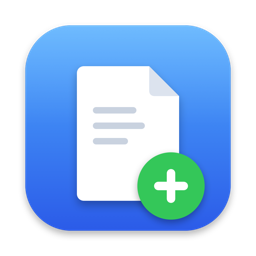

<p align="center"></p>

<h1 align="center">Blankly</h1>

<p align="center">Новый файл или папка там, где вы сейчас, на macOS.<br>
Нажмите <kbd>⌃⌥N</kbd>, выберите формат, введите имя.</p>

<p align="center"><a href="https://github.com/Guf-Hub/blankly/releases/latest"><b>⬇ Скачать для macOS</b></a></p>

<p align="center"><a href="README.md">English</a> | <b>Русский</b></p>

---

В macOS нет пункта «Создать → Текстовый документ», как в Windows. Blankly добавляет его маленьким фоновым приложением.

## Как пользоваться

- Нажмите **Control + Option + N**. У курсора появится меню.
- Выберите «Новая папка» или формат, введите имя, нажмите Enter.
- Файл создаётся в открытой папке Finder. Если вы в другой программе — на рабочем столе.
- В меню только те форматы, которые на вашем маке есть чем открыть. Нет Word или Pages — нет `.docx`.

Форматы: `txt`, `md`, `json`, `csv`, `html`, `py`, `docx`, `xlsx`, `pptx`, `odt`, `ods`, `odp`.
Офисные файлы — настоящие пустые документы, а не файлы нулевого размера, поэтому Word, Excel и LibreOffice открывают их без ошибок.

Файлы пустые, кроме `html` (заготовка страницы HTML5) и офисных документов.

**Свои шаблоны.** Настройки → **«Папка шаблонов…»** открывает папку. Любой файл, который вы туда положите, появится в меню в разделе «Мои шаблоны», и новые файлы будут его копией: `.py` с вашей заготовкой, конфиг `.yaml` — что угодно.

Настройки (внизу меню): сочетание клавиш, язык (English / Русский), запуск при входе в систему, папка шаблонов.

## Установка

**Через Homebrew:**

```bash
brew tap guf-hub/tap
brew trust --cask guf-hub/tap/blankly
brew install --cask guf-hub/tap/blankly
```

**Или вручную:**

1. Скачайте `Blankly-x.y.dmg` из [Releases](../../releases), откройте и перетащите Blankly в «Программы».
2. Запустите Blankly. Приложение не нотаризовано Apple, поэтому первый запуск macOS заблокирует:
   **Системные настройки → Конфиденциальность и безопасность → «Blankly заблокировано» → «Всё равно открыть»**.
3. На вопрос, можно ли Blankly управлять Finder, нажмите **«Разрешить»**. Это нужно, чтобы знать, какая папка открыта.
4. В меню откройте **«Настройки…»** и включите **«Запускать при входе в систему»**.

Нужна macOS 13 или новее, Apple Silicon или Intel.

## Сборка из исходников

Нужен Xcode или Command Line Tools.

```bash
zsh build.sh              # собрать и установить в /Applications
zsh build.sh --no-install # только собрать: build/Blankly.app, .zip и .dmg
```

`main.swift` — всё приложение, `icon.swift` рисует иконку, в `Resources/templates` лежат пустые офисные документы.

## Автор

[Guf-Hub](https://github.com/Guf-Hub). Идеи и ошибки — в [Issues](../../issues).

## Лицензия

MIT
