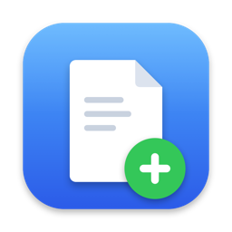
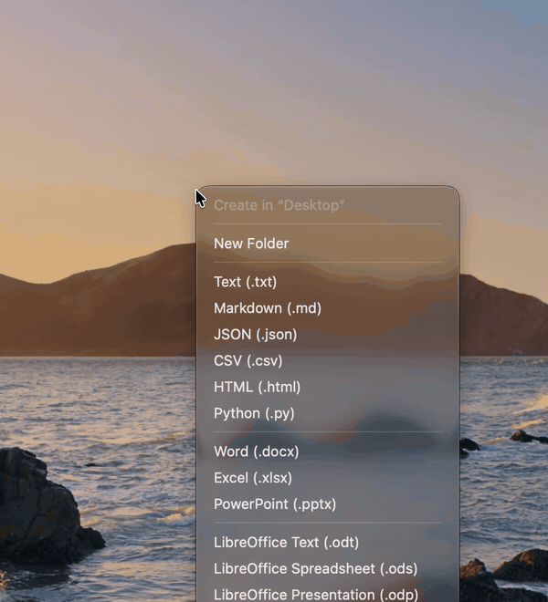

<div align="center">
<table><tr>
<td width="150" align="center" valign="middle"></td>
<td valign="middle" align="left">

<h1>Blankly</h1>

Новый файл или папка там, где вы сейчас, на macOS.<br>
Нажмите <kbd>Control</kbd> + <kbd>Option</kbd> + <kbd>N</kbd>, выберите формат, введите имя.

<a href="https://github.com/Guf-Hub/blankly/releases/latest"><b>⬇ Скачать для macOS</b></a> &nbsp;·&nbsp; <a href="#поддержать">♥ Поддержать</a> &nbsp;·&nbsp; <a href="../README.md">English</a> | <b>Русский</b>

<a href="https://github.com/Guf-Hub/blankly/releases/latest"></a>
<a href="https://github.com/Guf-Hub/blankly/releases"></a>

<a href="https://github.com/Guf-Hub/blankly/actions/workflows/test.yml"></a>
<a href="../LICENSE"></a>
<a href="https://github.com/Guf-Hub/blankly/stargazers"></a>

</td>
</tr></table>
</div>

<p align="center"></p>

---

В macOS нет пункта «Создать → Текстовый документ», как в Windows. Blankly добавляет его маленьким фоновым приложением.

## Как пользоваться

Открыть Blankly можно тремя способами:

- Нажмите **Control + Option + N** где угодно. Меню откроется рядом с курсором.
- Правый клик по пустому месту в окне Finder или на рабочем столе → **«Новый файл»** → формат.
- Кнопка Blankly на панели Finder (см. [Finder](#finder) ниже).
- Или своё сочетание на формат — например, **Control + Option + W** для Word — и меню не нужно вовсе (см. [Настройки](#настройки)).

Дальше выберите **«Новая папка»** или формат файла, введите имя и нажмите Enter. Имя уже подставлено и выделено — можно сразу печатать.

**Куда попадает файл**

- В Finder — в папку, открытую в переднем окне. Новый файл будет выделен.
- В любой другой программе — на рабочий стол, туда, где был курсор.
- Если имя занято, Blankly добавит номер: `Заметки 1.txt`.

**Форматы:** `txt`, `rtf`, `md`, `json`, `csv`, `html`, `py`, `docx`, `xlsx`, `pptx`, `odt`, `ods`, `odp`.

- Показываются только форматы, которые есть чем открыть. Нет Word или Pages — в меню не будет `.docx`.
- Ненужные форматы можно скрыть, а остальные перетащить в свой порядок: **Настройки → Форматы**. Меню, правый клик в Finder и кнопка на панели следуют ему. У скрытого формата сочетание клавиш продолжает работать.
- Файлы пустые, кроме `html` (заготовка HTML5) и документов Office.
- Файлы Office — настоящие пустые документы, а не файлы нулевого размера, поэтому Word, Excel и LibreOffice открывают их без ошибок.

**Свои шаблоны.** Настройки → **«Папка шаблонов…»** откроет папку. Любой файл, который вы туда положите, появится в меню в разделе «Мои шаблоны», а новые файлы будут его копиями — `.py` с вашей заготовкой, конфиг `.yaml`, что угодно. **Папка** тоже подойдёт: она появится в меню и скопируется целиком, со всем содержимым. В меню Finder они в пункте **«Другое…»**.

Так же добавляются форматы, которые умеет создавать только своя программа: Pages, Numbers, Keynote, Photoshop, AutoCAD, проект видеомонтажа. Создайте в ней пустой документ и сохраните его в папку шаблонов.

**Переменные в шаблонах.** В имени файла-шаблона и внутри текстовых шаблонов (UTF-8) Blankly заменяет `{date}` на `2026-11-05`, `{time}` на `14-30`, `{name}` на введённое вами имя. У шаблона-папки то же касается имён файлов внутри. Бинарные файлы (например, `.docx`) копируются без изменений. Имя, которое предлагается в окне, — это имя шаблона с подставленными `{date}` и `{time}`.

**Из буфера обмена.** Если в буфере текст или картинка, в меню появляется **«Из буфера обмена…»** (и в правом клике Finder). Текст станет `.txt`; корректный JSON (объект или массив) — `.json`; текст, начинающийся с `<!DOCTYPE` или `<html`, — `.html`. Картинка станет `.png`. Дальше Blankly спросит имя (по умолчанию «Из буфера») и сохранит файл.

## Настройки

Откройте меню (Control + Option + N) → **«Настройки…»** внизу.

| Настройка | Что делает |
|---|---|
| Сочетание клавиш | Нажмите на поле и нажмите новое сочетание. Нужна клавиша ⌘, ⌃ или ⌥. Esc или переход в другую программу — отмена. Если сочетание занято другой программой, Blankly скажет об этом. |
| Форматы | **«Настроить…»** открывает список: новая папка и все форматы. В каждой строке — галочка **«Показывать»** (хотя бы один пункт должен остаться), поле сочетания и **«Открывать в…»**: программа по умолчанию для этого типа файлов (macOS попросит подтвердить смену). Строки можно перетаскивать, чтобы задать порядок. Для сочетания нажмите на поле и **Control + Option** + клавишу. Потом по этому сочетанию Blankly сразу спросит имя и создаст файл, без меню. В меню сочетание видно справа от своего формата. Если сочетание уже занято меню Blankly, другим форматом, macOS (Настройки → Клавиатура → Сочетания клавиш) или другой программой, Blankly предупредит. Control + Option обязательны: какие сочетания другие программы используют в своих меню, macOS не сообщает, а эту пару они почти не берут. |
| Язык | English, Русский, Deutsch, Français, Español, 简体中文 или 日本語. По умолчанию — язык системы, если его нет в списке, то английский. |
| Запускать при входе в систему | Blankly стартует в фоне при входе, и сочетание клавиш всегда работает. |
| Правый клик в Finder | **«Включить…»** открывает список расширений Finder в macOS — включите там Blankly. |
| Открывать файл сразу после создания | По умолчанию выключено. Если включить, новый файл откроется в программе по умолчанию. Папка только выделяется в Finder. Если файл нечем открыть, он просто выделяется. |
| Проверять обновления раз в день | См. [Обновления](#обновления). |
| Папка шаблонов… | Открывает папку со своими шаблонами. |

## Finder

Правый клик и кнопка на панели — это расширение Finder внутри Blankly. Включается один раз: Настройки → **«Включить…»** рядом с «Правый клик в Finder» → включите Blankly в списке.

Кнопка на панели — по желанию. Правый клик по панели Finder → **«Настроить панель инструментов…»** → перетащите Blankly на панель. По нажатию — тот же список форматов.

macOS всегда ставит пункты сторонних программ в конец меню правого клика — поднять пункт Blankly выше нельзя.

В iCloud Drive macOS вообще не показывает пункты программ в меню правого клика. Там работают кнопка на панели Finder и Control + Option + N.

## Обновления

Blankly обновляется сам через [Sparkle](https://sparkle-project.org) — стандартную библиотеку обновлений для Mac.

- Раз в день он читает небольшой файл из последнего релиза на GitHub. Если вышла новая версия, вверху меню появится «Доступна версия X — обновить». Нажмите, затем **«Установить обновление»** — Blankly скачает новую версию, заменит себя и перезапустится. Никаких внезапных окон.
- Проверить можно и вручную: меню → **«Проверить обновления…»**
- Каждое обновление подписано личным ключом автора, и Blankly не поставит обновление с неверной подписью — даже если кто-то получит доступ к аккаунту GitHub.
- О вас и вашем Mac ничего не отправляется. Ежедневную проверку можно выключить в настройках.
- Ставили через Homebrew? Обновления приходят так же, `brew upgrade` не нужен.

В версиях 1.0–1.2 Sparkle ещё нет: обновитесь до 1.3 один раз вручную (или `brew upgrade --cask blankly`), дальше — автоматически.

## Установка

**Homebrew:**

```bash
brew tap guf-hub/tap
brew trust --cask guf-hub/tap/blankly
brew install --cask guf-hub/tap/blankly
```

**Или вручную:** скачайте `Blankly.dmg` из [последнего релиза](https://github.com/Guf-Hub/blankly/releases/latest), откройте и перетащите Blankly в «Программы».

**Первый запуск** (в обоих случаях):

1. Откройте Blankly из «Программ». Blankly не заверен в Apple (для этого нужен платный аккаунт разработчика), поэтому в первый раз macOS покажет окно *«Файл "Blankly.app" не был открыт. Apple не удалось подтвердить…»*. Так и должно быть. Пройти его нужно один раз:
   1. Нажмите **«Готово»**. **Не** нажимайте «Переместить в Корзину».
   2. Откройте  → **Системные настройки** → **Конфиденциальность и безопасность**.
   3. Прокрутите вниз до раздела «Безопасность». Рядом со строкой *«Использование "Blankly.app" заблокировано…»* нажмите **«Всё равно открыть»** и подтвердите паролем или Touch ID.
   4. В появившемся окне ещё раз нажмите **«Открыть всё равно»**.

   Дальше Blankly открывается как обычно. Удобнее через Терминал? Эта команда делает то же самое:
   ```bash
   xattr -dr com.apple.quarantine /Applications/Blankly.app
   ```
2. На вопрос, можно ли Blankly управлять Finder, нажмите **«Разрешить»**. Это нужно, чтобы знать, какая папка открыта.
3. Откройте **«Настройки…»** и включите **«Запускать при входе в систему»**.
4. По желанию включите расширение Finder — см. [Finder](#finder).

Нужна macOS 13 или новее. Apple Silicon и Intel.

## Удаление

```bash
brew uninstall --zap --cask blankly
```

Без Homebrew: закройте Blankly (меню → **«Выйти»**), перетащите его из «Программ» в Корзину и удалите `~/Library/Application Support/Blankly` (ваши шаблоны), если они не нужны.

## Сборка из исходников

Нужен Xcode или Command Line Tools.

```bash
zsh build.sh              # собрать и установить в /Applications
zsh build.sh --no-install # только собрать: build/Blankly.app, .zip и .dmg
zsh release.sh --notes "…" --notes-ru "…" # для автора: собрать, подписать обновление, выложить релиз на GitHub
```

**Выпуск релиза (для автора).** `--notes` (Markdown) попадает и в релиз на GitHub, и в окно обновления Blankly; `--notes-ru` добавляет русский текст — его увидят на Mac с русским языком. Остальные аргументы уходят в `gh release create` (например, `--prerelease`).

Локально сборка подписывается ad-hoc. Сборку с подписью Developer ID и нотаризацией Apple делает GitHub Actions: запустите workflow **release-build** (Actions → release-build → Run workflow), затем опубликуйте результат командой `zsh release.sh --from-ci <номер-прогона> --notes "…"`. Архив обновления по-прежнему подписывается ключом Sparkle на Mac автора. Если секретов подписи нет, workflow просто соберёт ad-hoc-версию. Подробности — в [CONTRIBUTING.md](../CONTRIBUTING.md#code-signing-maintainers) (на английском).

Первая сборка скачивает [Sparkle](https://github.com/sparkle-project/Sparkle) 2.10.0 в `.vendor/` и сверяет его SHA-256.

| Файл | Что в нём |
|---|---|
| `main.swift` | Приложение: меню, создание файлов, сочетания, окна настроек и «Форматы» |
| `Core.swift` | Логика без интерфейса: строки на 7 языках, имена, шаблоны и переменные, буфер обмена, конфликты сочетаний |
| `Formats.swift` | Список встроенных форматов (общий с расширением Finder) |
| `FormatOrder.swift` | Порядок и скрытие форматов (общий с расширением Finder) |
| `Languages.swift` | Языки и выбор языка (общий с расширением Finder) |
| `FinderExtension.swift` | Расширение Finder: правый клик и кнопка на панели |
| `icon.swift` | Рисует иконку |
| `Resources/templates` | Пустые офисные документы |
| `build.sh`, `sign.sh`, `release.sh` | Сборка, подпись, выпуск |

Правила для ИИ-агентов: [AGENTS.md](../AGENTS.md).

### Тесты

`zsh test.sh` собирает всё, кроме `main.swift` (логику, список и порядок форматов, языки и расширение Finder), вместе с `Tests/*.swift` обычным `swiftc` (проект Xcode не нужен) и завершается с ошибкой, если что-то не так. Проверяются нумерация имён, конфликты сочетаний, наличие каждой строки на каждом языке, порядок форматов, что самые длинные названия влезают в окно «Форматы», шаблоны и переменные (в том числе папки-шаблоны) и корректность офисных шаблонов (zip). CI на каждом pull request запускает тесты и полную сборку.

## Участие в разработке

Pull request'ы приветствуются — см. [CONTRIBUTING.md](../CONTRIBUTING.md) (на английском). Ошибки — в [Issues](https://github.com/Guf-Hub/blankly/issues/new/choose), идеи и вопросы — в [Discussions](https://github.com/Guf-Hub/blankly/discussions).

## Поддержать

Blankly бесплатный и останется бесплатным. Если он экономит вам время и хочется сказать спасибо — небольшой донат поможет его развивать.

<table><tr>
<td align="center" valign="middle"></td>
<td>

**USDT · сеть TON**

```
UQBQ3pthdJ3qGhAgNbeo95fsqeauO1R65JFuCPlVdbvvJEvF
```

Отсканируйте QR-код в приложении кошелька или скопируйте адрес.

⚠️ Только **USDT** и только в сети **TON**. Другие монеты или сети на этот адрес потеряются.

</td>
</tr></table>

## Автор

[Guf-Hub](https://github.com/Guf-Hub). Идеи и ошибки — в [Issues](https://github.com/Guf-Hub/blankly/issues/new/choose).

## Лицензия

MIT
